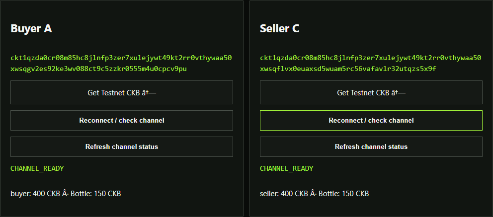
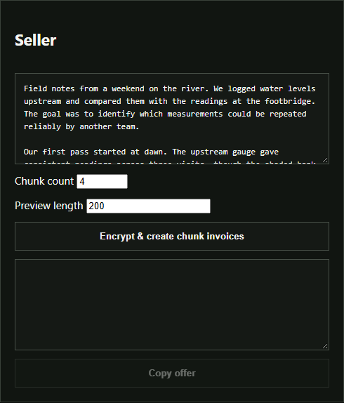
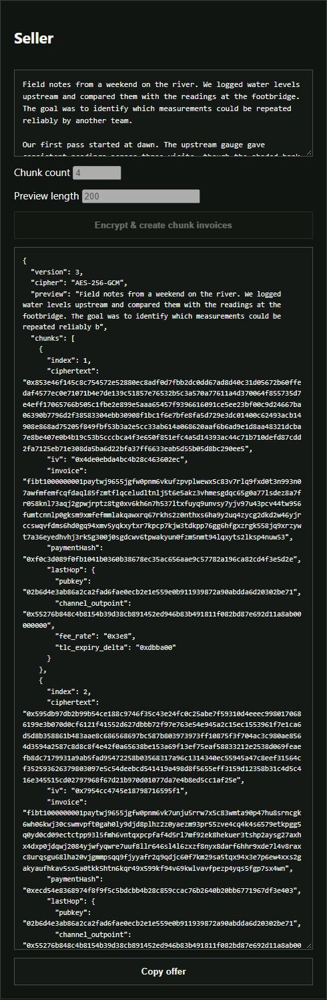
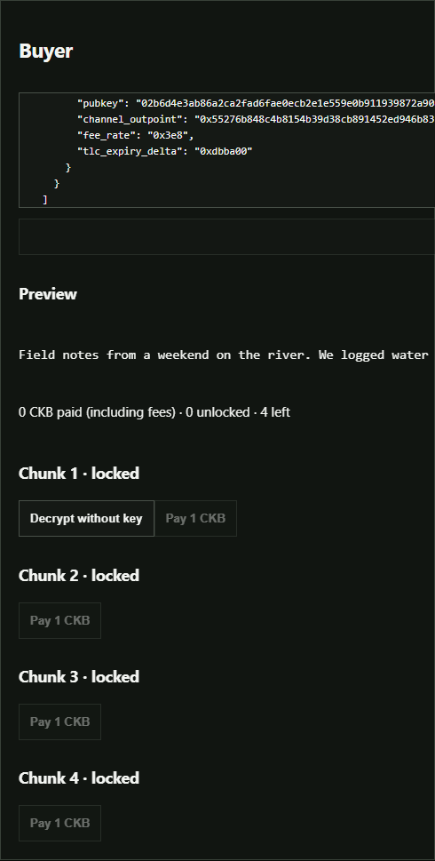
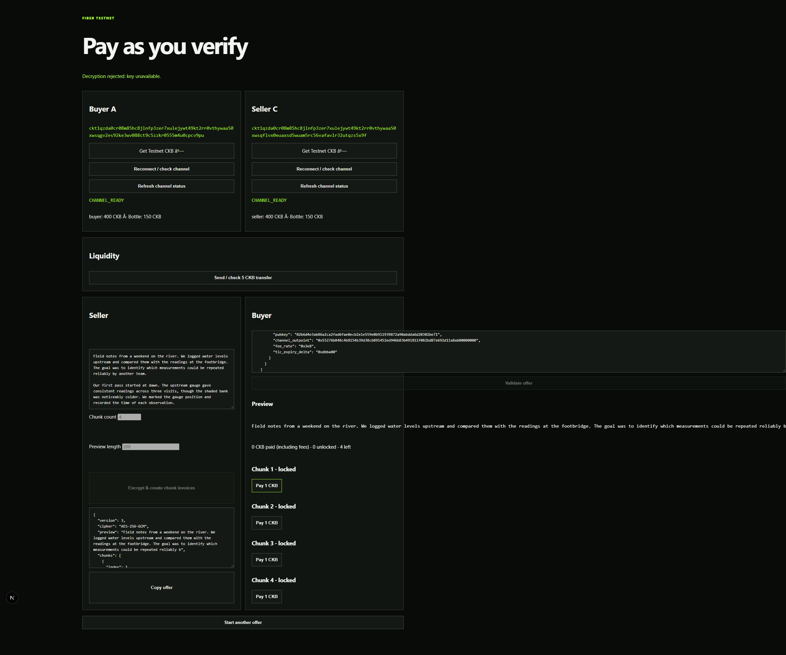
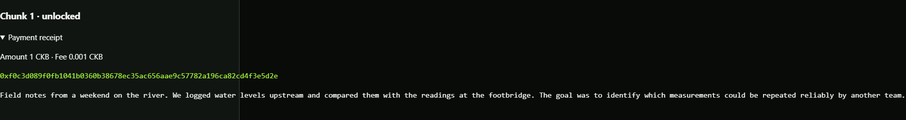
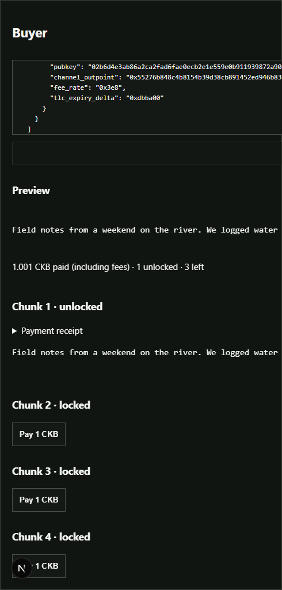
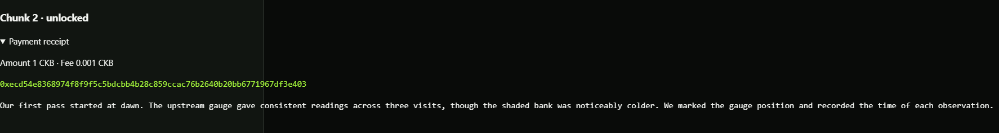
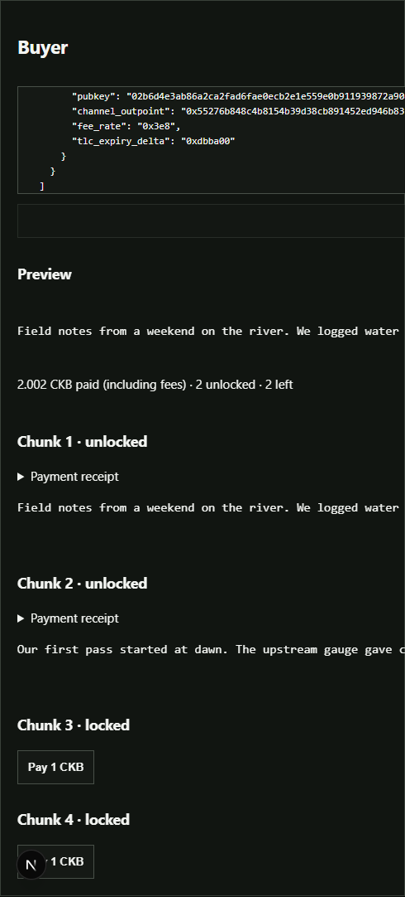
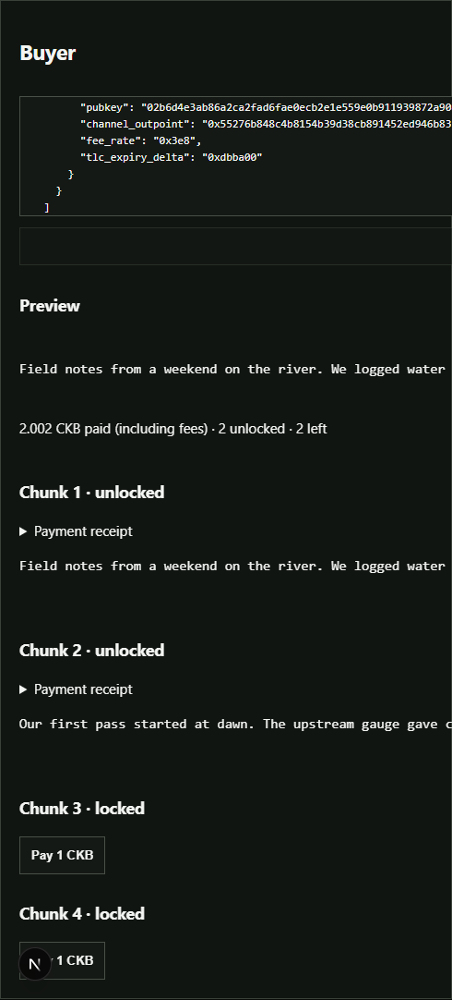

# Pay as you verify

A Build on CKB Campaign #8 Advanced Quest submission. Buy a document one chunk at a time over Fiber on CKB Testnet.

## Why

The original flow releases a key when the buyer pays for the entire document. Successful decryption establishes that the key works for the ciphertext. The buyer still has to judge the value of the content. Here, a clear-text opening and independently payable chunks let the buyer read as they go and stop spending whenever they choose. [Fiber tutorial](https://www.fiber.world/docs/build/encrypted-data-payment)

## What changed

- The seller sets a chunk count and preview length, defaulting to four chunks and 200 characters.
- The splitter prefers paragraph breaks, then sentence boundaries, and uses whitespace when more breaks are needed.
- Each chunk gets independently sampled AES key material and its own IV.
- The JSON offer contains the opening preview and indexed ciphertext, IV, hash, and invoice entries.
- Each buyer row pays separately, unlocks in place, and shows its receipt. The buyer panel counts paid CKB, unlocked chunks, and chunks left.

## What is unchanged

The starter handles node startup, faucet funding, channel opening, and routing through Bottle on Testnet. Each invoice costs 1 CKB and commits to the SHA-256 hash of the AES-256-GCM key. Settlement releases that key as the payment preimage.

## Run locally

Use Node.js 22.18 or newer and npm. From the cloned repository root, run

```sh
cd encrypted-data-payment
npm install
npm run dev
```

Open http://localhost:3001 in a browser with Web Locks and SharedArrayBuffer. Keep the same browser profile and one app tab so you can reuse saved nodes. [CKB Testnet faucet](https://faucet.nervos.org)

## Try the flow

1. Start Buyer A and Seller C. Fund each node's displayed Testnet address with enough for a 500 CKB channel and its on-chain fee.
2. Open each channel and refresh until both show `CHANNEL_READY`. Check Bottle’s balance on the seller channel. Use the starter’s **Send / check 5 CKB transfer** if inbound liquidity is needed.
3. Keep the sample document or paste your own. Set the chunk count and preview length, then click **Encrypt & create chunk invoices**.
4. Copy the JSON into **Received offer** and click **Validate offer**. Check the preview and the four locked rows.
5. Click **Decrypt without key** on chunk 1 and confirm the rejection.
6. Pay for chunk 1, open its receipt, and read the unlocked text. Repeat for chunk 2.
7. Stop with chunks 3 and 4 locked. If a payment is pending or the page was refreshed, validate the saved offer and use **Check payment status** to recover its receipt and text.

## What it does not do

Content quality, authorship, and the relationship between the preview and the paid text depend on the seller. The app has no refunds or dispute process. The clear-text opening can overlap paid chunk text. The demo uses Testnet only.

## Fees

At 0.001 CKB routing fee per payment, the cost is 1.001 CKB per chunk or 1.004 CKB for all four. After two payments the expected total is 2.002 CKB. The app sums actual fees reported by Fiber, which can vary.

## Demo

[Capture shot list](docs/screenshots/SHOTLIST.md) · [Recording script](docs/RECORDING.md) · [Demo recording, pending capture](docs/pay-as-you-verify-demo.mp4)

<details>
<summary>Demo screenshots</summary>





















</details>
